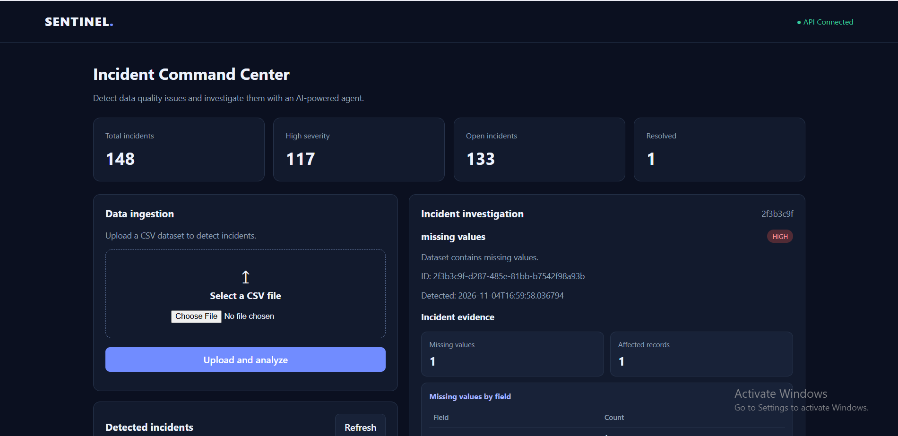
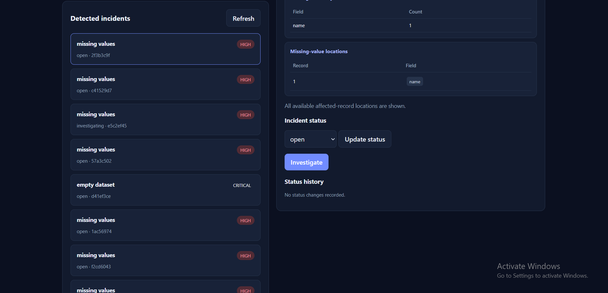
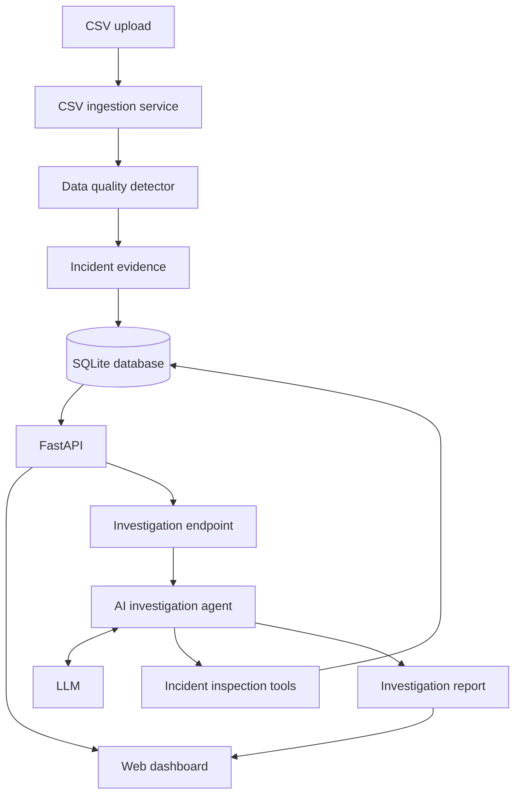

# Sentinel AI Agent

**AI-powered data quality monitoring and incident investigation built with Python, FastAPI, SQLite, and an LLM-powered tool-calling agent.**

Sentinel ingests CSV data, detects data-quality incidents using deterministic checks, stores incident evidence, and uses an AI agent to investigate incidents through a small set of focused tools. Investigation results distinguish observed evidence from possible explanations and do not claim a confirmed root cause without sufficient support.

> **Project status:** Core demo implemented. Latest verified test run: **34 passed**.

## Dashboard




## Features

- **CSV ingestion** — upload CSV files through the web dashboard/API.
- **Data-quality detection** — detect missing values, duplicate records, schema drift, and type mismatches.
- **Evidence collection** — retain relevant record locations, field-level counts, and bounded examples.
- **Incident persistence** — store incidents and status history in SQLite.
- **AI investigation** — investigate an incident using a custom agent loop and dynamic tool calling.
- **Investigation tools** — inspect an incident, inspect its evidence, find related incidents, and inspect status history.
- **Readable dashboard** — review incidents, evidence, status transitions, and investigation findings.

## Architecture



## Demo workflow

1. Start the application and open the dashboard.
2. Upload a CSV file containing data-quality problems.
3. Review the detected incidents.
4. Select an incident and inspect its evidence.
5. Run an AI investigation.
6. Review the investigation findings and root-cause uncertainty.
7. Change the incident status and review its status history.

A demo CSV dataset is included in the project if the file is present in the repository. You can also upload your own CSV.

## Technology stack

| Area | Technology |
|---|---|
| Language | Python |
| API | FastAPI |
| Data validation | Pydantic |
| Persistence | SQLite, SQLAlchemy |
| AI integration | Google GenAI SDK |
| Agent pattern | Custom tool-calling loop |
| Frontend | HTML, CSS, JavaScript |
| Tests | Pytest, FastAPI TestClient |

## Project structure

```text
sentinel-ai-agent/
├── app/
│   ├── agents/
│   ├── api/
│   ├── core/
│   ├── database/
│   ├── models/
│   ├── services/
│   ├── config.py
│   └── main.py
├── docs/
│   └── screenshots/
├── static/
│   └── index.html
├── tests/
├── .env.example
├── .gitignore
├── pytest.ini
├── requirements.txt
└── README.md
```

## Getting started

### Prerequisites

- Python 3.12 recommended
- An AI API key configured locally for AI investigation

### 1. Clone the repository

```bash
git clone https://github.com/vishal-benake/sentinel-ai-agent.git
cd sentinel-ai-agent
```

### 2. Create and activate a virtual environment

Windows PowerShell:

```powershell
python -m venv .venv
.venv\Scripts\Activate.ps1
```

### 3. Install dependencies

```powershell
pip install -r requirements.txt
```

### 4. Configure environment variables

Copy the example environment file:

```powershell
Copy-Item .env.example .env
```

Add your own required AI API credential to `.env`, using the variable name expected by the application configuration. Keep `.env` private; do not commit API keys.

### 5. Run the application

```powershell
uvicorn app.main:app --reload
```

Open the dashboard at:

- http://127.0.0.1:8000

Interactive API documentation:

- http://127.0.0.1:8000/docs

Health check:

- http://127.0.0.1:8000/health

## Run tests

From the repository root:

```powershell
pytest -v
```

Latest verified result:

```text
34 passed
```

## Scope and limitations

Sentinel is an AI engineering portfolio/demo project. Incident detection is deterministic; the AI agent investigates the evidence made available through its tools. An investigation may identify plausible explanations, but a root cause is not treated as confirmed unless the available evidence supports that conclusion.

Automated remediation and production-scale deployment infrastructure are outside the current implemented scope.

## Future improvements

- Persist investigation reports
- Add more data-quality checks
- Expand investigation evaluation
- Add human-reviewed remediation workflows

---

Built as an AI engineering portfolio project.

---

## Author

**Vishal Benake**

AI Engineering | Python | Agent Development

GitHub: [@vishal-benake](https://github.com/vishal-benake)

---

*Built with curiosity, persistence, and a passion for AI engineering.*
